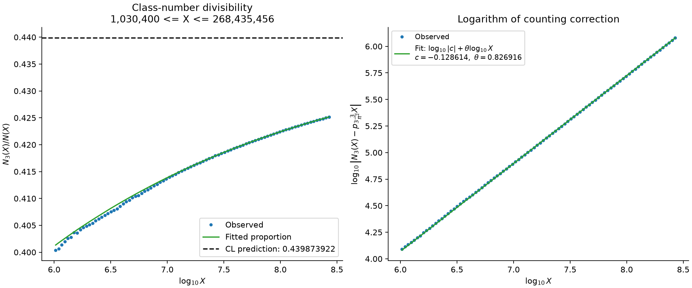
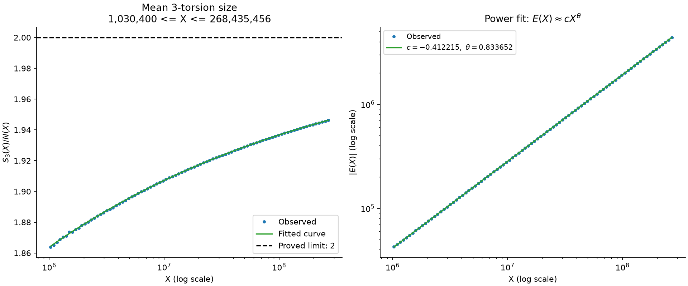
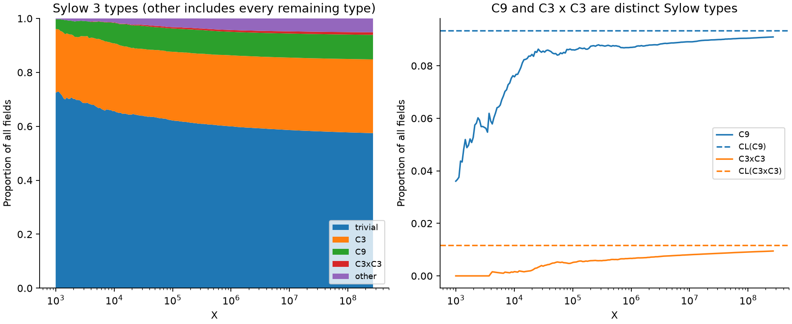

# Cohen–Lenstra Asymptotics

本轮只使用原始 LMFDB 数据，研究三个对象：

| 对象 | 统计与拟合 |
|---|---|
| $3\mid h_D$ | 整除计数、整除比例及候选二阶项 |
| $\mathrm{Cl}_D[3]$ | torsion 总和、平均值及修正项 |
| Sylow $3$ 子群 | 完整类型分布，包含 $C_9$、$C_3\times C_3$ 的比例与拟合 |

当前数据覆盖 $|D|<2^{28}$，包含 **81,594,634 个虚二次域、37 种实际出现的 Sylow 类型**。

## Codespaces 一键复现

打开 Codespace 后会自动安装锁定版本的依赖，并取回四个原始 Git LFS 文件。随后运行：

```bash
source .venv/bin/activate
python -m scripts.reproduce --check
```

从当前汇总表生成 **8 张图、42 组拟合和完整计算说明**。如果要从全部原始记录重新计算：

```bash
python -m scripts.reproduce --rebuild --check
```

## 计算说明与结果

**[本轮完整计算说明](results/calculations.md)** 随复现命令自动更新，包含：

- 每条原始记录如何变成 Sylow 类型、3-rank、torsion 大小及整除指标。
- 主项常数、自同构群大小、两种误差的定义及当前端点的数值代入。
- 最小二乘目标、实际拟合区间、所有系数、RMSE、残差和截点检查。
- 如何从拟合的计数误差还原计数、整除比例、Sylow 比例及 torsion 平均值。

[数据格式](DATA_FORMAT.md) · [当前汇总](data/processed) · [拟合系数](results/fit_summary.csv) · [全部图像](figures/statistics)





## 单独拟合

```bash
python -m experiments.fit --observable divisible --error xuzhu --model power
python -m experiments.fit --observable torsion --error xuzhu --model five_sixths
python -m experiments.fit --group C9 --error conditional --model power
python -m experiments.fit --group C3xC3 --error conditional --model power
```

用 `--xmin`、`--xmax` 选择区间；单独拟合的逐点数据、残差、图像和参数写入 `results/custom/`。

## 扩展原始数据

```bash
python -m scripts.download_data --xmax 10000000000 --dry-run
python -m scripts.reproduce --download --xmax 10000000000
```

扩展到 $10^{10}$ 需要 152 个文件，扫描约 30.4 亿条记录。扩展数据与结果默认写入独立的 `extended_BOUND` 目录。

CL 的整除概率和固定 Sylow 类型分布是猜想输入；数值拟合不构成二阶项或余项的证明。累计检查点彼此相关。GitHub Actions 在 Ubuntu/Python 3.12 上验证测试及完整的汇总表到报告流程。
