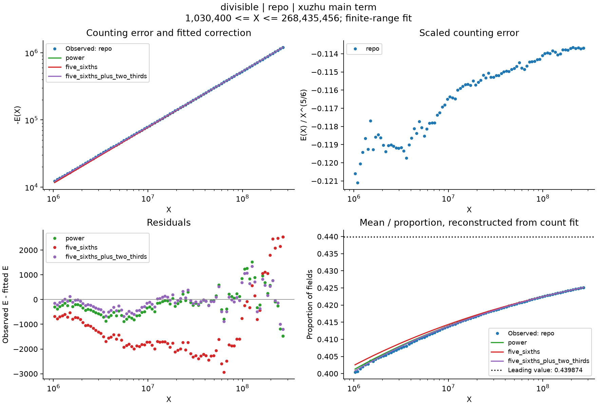
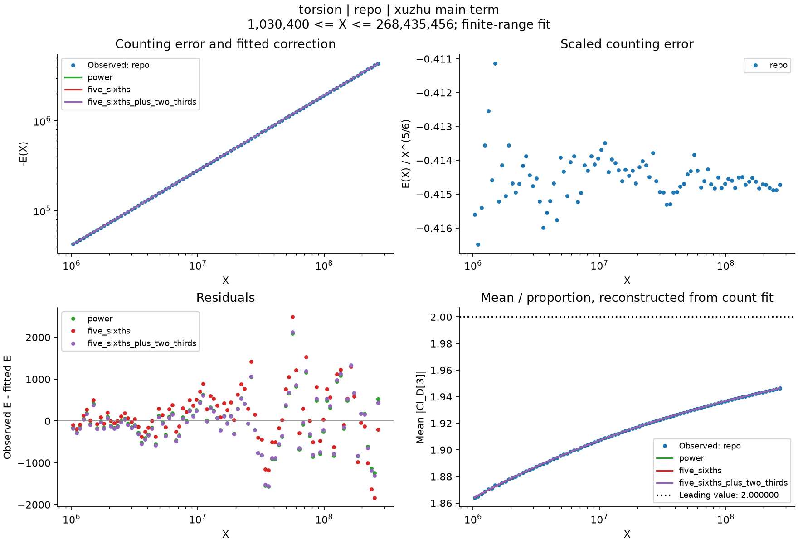

# Cohen–Lenstra Asymptotics

Reproducible statistics for imaginary quadratic fields, with separate experiments for:

1. Class-number divisibility: how often does `3 | h_D`?
2. The size of `Cl_D[3]`, including its mean and secondary correction.
3. The entire Sylow 3 subgroup, including the distinct types `C9` and `C3 x C3`.

All original raw files, the original `data/processed/p3_counts.csv`, and the two original C9 figures are preserved. New statistics and figures live in separate files.

## Reproduce in GitHub Codespaces

Open this repository in a Codespace. Its setup installs the pinned Python dependencies, Git LFS, and the C++/zlib scanner, and retrieves the four original gzip files (about 363 MB in total).

After setup:

```bash
source .venv/bin/activate
python -m scripts.reproduce --check
```

This regenerates **all 10 plots and 54 model fits** from the committed summaries. It also runs the mathematical and data-integrity tests. The figures appear under `figures/statistics/`; coefficients and range checks appear under `results/`.

To rebuild the summaries from **all 81,594,634 original records**, then regenerate the same report:

```bash
python -m scripts.reproduce --rebuild --check
```

The default scanner is C++ for speed and bounded memory. `--engine python` uses the independently tested reference decoder. The two implementations are compared on synthetic fixtures, including block and checkpoint boundaries.

GitHub Actions runs the tests and complete summary-to-report reproduction on Ubuntu with Python 3.12. It uploads the resulting plots and fit tables. CI does not download the large LFS files or rerun the full 81-million-record scan.

## Mathematical objects

Write `K_D = Q(sqrt(D))` for negative fundamental discriminants `D`, and let `N(X)` count these fields with `0 < |D| <= X`. Then `N(X) ~ (3/pi^2) X`.

| Object | Meaning | Example when the Sylow 3 subgroup is C9 |
|---|---|---|
| `Cl_D[3^infinity]` | Entire Sylow 3 subgroup | C9 |
| `Cl_D[3]` | Elements annihilated by 3, including the identity | C3, size 3 |
| `1[3 divides h_D]` | Whether the Sylow 3 subgroup is nontrivial | 1 |

If the Sylow subgroup is `C_(3^a1) x ... x C_(3^ar)`, then `|Cl_D[3]| = 3^r`. In particular, `C3 x C3` contributes **9** to the torsion sum; `C9` contributes **3**.

The decoder's old `Cl3_K_invariants` name is retained for compatibility. Its explicit alias `sylow3_invariants` describes the entire primary part. `rank3` and `torsion3_size` describe the torsion statistic.

## 1. Divisibility and its secondary term

Define

```text
N_div(X) = # {D : 0 < |D| <= X, 3 divides h_D}
p3       = 1 - product_(j>=1)(1 - 3^(-j)) = 0.439873922072...
E_div(X) = N_div(X) - p3 * (3/pi^2) * X
```

`N_div(X) = N(X) - N_trivial(X)` exactly. Use the full CL constant, rather than rounding it to `0.44` and introducing a spurious linear error.

Fit `E_div(X)` to `A X^theta`, `A X^(5/6)`, and `A X^(5/6) + B X^(2/3)`. The report shows the error, scaled error, residuals, and the divisibility proportion reconstructed from each count fit.



The CL leading coefficient here is conjectural. A good finite-range fit does not prove the asymptotic or an `o(X^theta)` remainder.

## 2. Torsion sum and mean

```text
S3(X)       = sum_D |Cl_D[3]|
Avg3(X)     = S3(X) / N(X)
E_torsion(X)= S3(X) - (6/pi^2) * X
```

The Davenport–Heilbronn mean is **2**, including the identity. The known secondary term has scale `X^(5/6)` in the sum and `X^(-1/6)` in the mean. The main coefficient of the sum is **6/pi^2**, not `3/pi^2`.

The complete histogram of Sylow types is included in this sum; it is not approximated using only the four original target groups.



The mean curves are obtained by dividing the fitted total by the actual `N(X)`. They are not separate unweighted least-squares fits to the mean. See [Bhargava–Shankar–Tsimerman, Theorems 2 and 4](https://arxiv.org/abs/1005.0672).

## 3. Sylow types and their proportions

For a fixed finite abelian 3-group `G`, define

```text
N_G(X) = # {D : Cl_D[3^infinity] is isomorphic to G}
P_CL(G)= eta3 / |Aut(G)|,  eta3 = product_(j>=1)(1 - 3^(-j))
E_G(X) = N_G(X) - P_CL(G) * (3/pi^2) * X
```

The default report fits `trivial`, `C3`, `C9`, `C3xC3`, and `other`. Proportions always use **all fields** as the denominator; the four selected types are not renormalized to sum to one. `other` contains every remaining type and has CL mass equal to one minus the four selected masses. The baseline data contains 37 observed Sylow types; `sylow3_types.csv` records all of them, and any observed type can be fitted by name.


## Data ranges and preserved baseline

| Data source | Range | Available statistics |
|---|---|---|
| Four original LMFDB files, `k=0` | `|D| < 2^28` | All three observables; 81,594,634 fields |
| Mosunov–Jacobson, Tables 7–8 | 11 checkpoints from `10^11` to `2^40` | Divisibility counts and total field counts |

The paper's large-range aggregates are committed separately under `data/published/`, with provenance. They are **not** additional raw records. Published, repository, and combined fits are labelled separately; no observations are invented across the gap between `2^28` and `10^11`. Published rank-2/rank-3 tables are not used to reconstruct a torsion sum, because higher ranks also occur.

The full [LMFDB source tables](https://www.lmfdb.org/NumberField/QuadraticImaginaryClassGroups) cover `|D| < 2^40`. To extend the raw-data analysis to `10^10`:

```bash
# Inspect the 152 required files first; the original four are already present.
python -m scripts.download_data --xmax 10000000000 --dry-run

# Download the remaining blocks, rebuild all three statistics, and refit.
python -m scripts.reproduce --download --xmax 10000000000
```

This is a multi-gigabyte download and a scan of about 3.04 billion records. Downloads are sequential, validated as gzip, and written atomically. Extra raw blocks are ignored by Git. The builder rejects missing blocks or residue classes, and never extends a cumulative count beyond the requested verified input range. `--xmax` requires `--rebuild` or `--download`.

Bounds other than `2^28` write separate `data/extended_BOUND/`, `results/extended_BOUND/`, and `figures/statistics/extended_BOUND/` directories by default. The committed baseline summaries and results remain intact. Explicit directory flags can select another destination.

## Individual experiments

```bash
python -m experiments.fit --observable divisible --error xuzhu --model power --xmin 1000000
python -m experiments.fit --observable torsion --error xuzhu --model five_sixths --xmin 1000000
python -m experiments.fit --observable sylow --group C3xC3 --error conditional --model power
python -m experiments.fit --observable divisible --source published --error xuzhu --model power --xmin 100000000000

# The previous interface remains valid:
python -m experiments.fit --group C9 --error conditional --model power --xmin 1000000
```

Custom runs write JSON, plotted data/residual CSV, and PNG to `results/custom/`. See [EXPERIMENTS.md](EXPERIMENTS.md) for loss functions, error conventions, and range checks; [DATA_FORMAT.md](DATA_FORMAT.md) for decoding and column definitions.

The report uses cumulative checkpoints, so residuals are correlated. Reported RMSE and AIC/BIC are descriptive; no independent-error confidence intervals are claimed. The original C9 baseline (`theta ~ 0.832998`, conditional error, `X >= 10^6`) remains reproducible.
